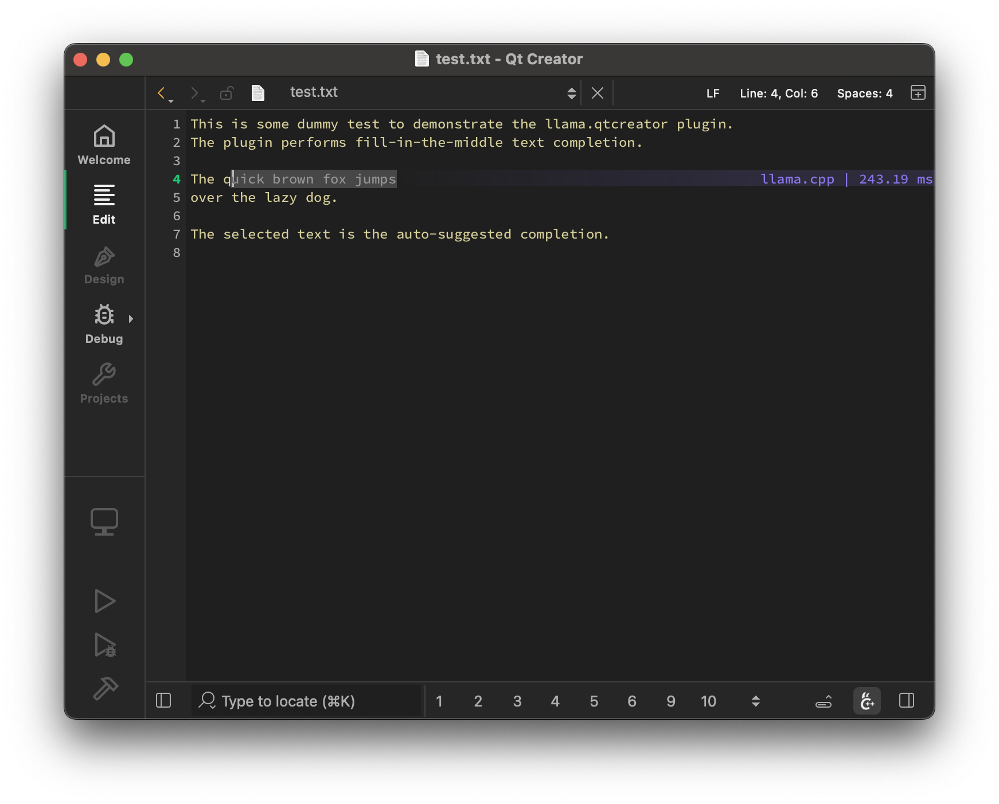
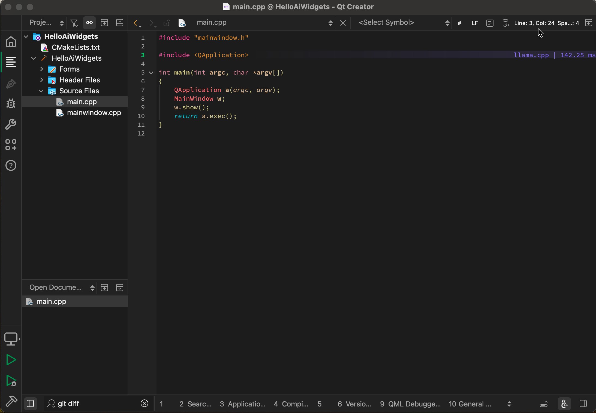
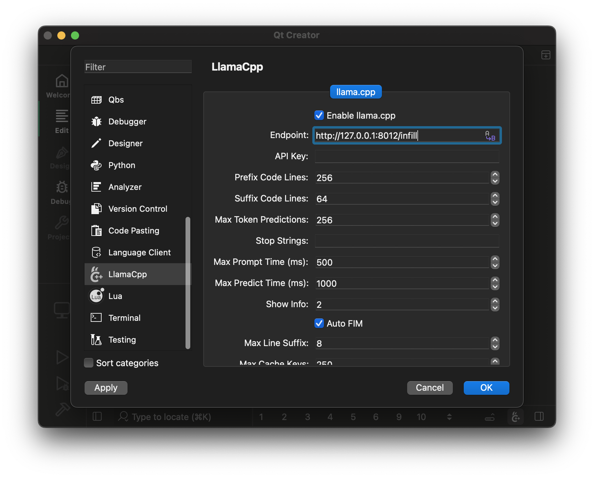
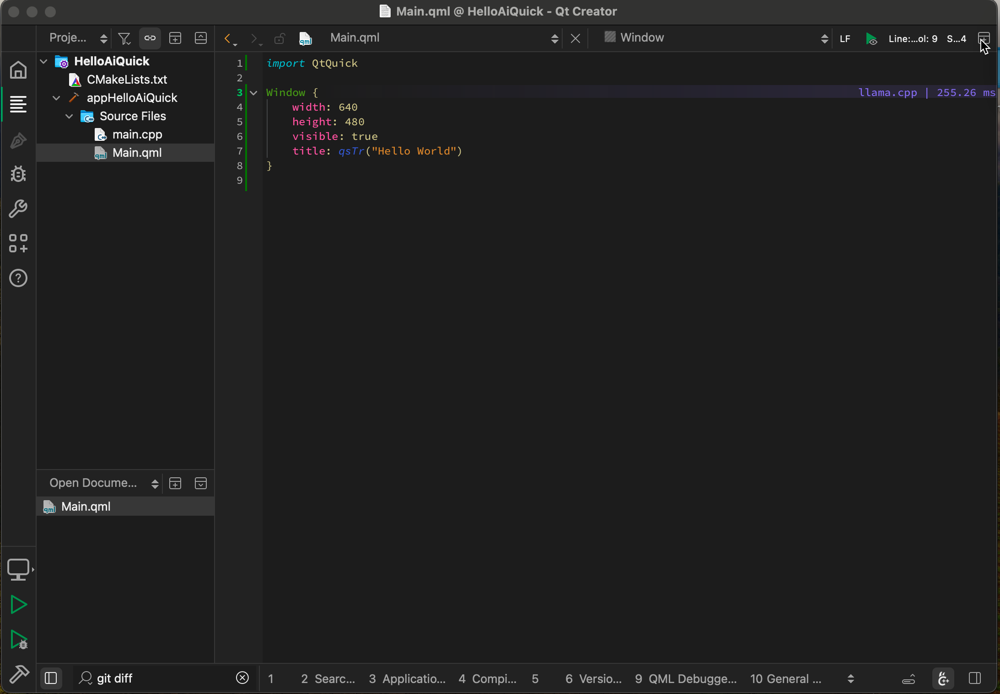

# llama.qtcreator

Local LLM assistance for Qt Creator: FIM text completion in the editor and an
agentic chat, both powered by a [llama.cpp](https://github.com/ggml-org/llama.cpp)
server.



---




## Features

### Text completion

- Auto-suggest on cursor movement. Toggle enable / disable with `Ctrl+Shift+G`
- Trigger the suggestion manually by pressing `Ctrl+G`
- Accept a suggestion with `Tab`
- Accept the first line of a suggestion with `Shift+Tab`
- Cycle through alternative completions with `Ctrl+G Down` / `Ctrl+G Up`
- Control max text generation time
- Configure scope of context around the cursor
- Ring context with chunks from open and edited files and yanked text
- [Supports very large contexts even on low-end hardware via smart context reuse](https://github.com/ggml-org/llama.cpp/pull/9787)
- Speculative FIM support
- Speculative Decoding support
- Display performance stats

### Chat

- Chat support (including [Mermaid](https://mermaid.js.org/) diagrams and [KaTeX](https://katex.org/) math, rendered to SVG with a bundled QuickJS runtime - no browser required)
- "Human Editor" endpoint: select it in the chat's model dropdown to use the chat as a Markdown editor - replies are written by you in a regular text editor opened in a split next to the chat (save to send), and assistant messages can be edited in place the same way
- Source and Image drag & drop support
- "ll" locator (type `ll` in the locator, or use the selection prompt button in the editor): send the current editor selection to the model with a built-in or custom prompt - prompts support `{selection}`, `{file}`, `{line}`, `{diagnostics}` and `{git_diff}` placeholders, and are editable on the "Prompts" settings page
- Project instructions: the project's `AGENTS.md` / `CLAUDE.md` (searched up to the git repository root) is loaded and appended to the chat system message; can be disabled globally or per project
- [Skills](https://agentskills.io): configure skill directories on the "Skills" settings page; skills (`SKILL.md` files) are advertised to the model and loaded on demand via the `skill` tool
- Conversations get automatic titles, long conversations are automatically continued in a new conversation seeded with a handoff summary of the task, current state and next steps when they approach the model's context window, and messages sent while a reply is in progress are queued
- Export a conversation as Markdown or HTML
- [Tools usage](https://github.com/cristianadam/llama.qtcreator/wiki/Tools)

### Chat tools

- File tools (`read_file`, `write`, `edit_file`, `apply_patch`), code
  navigation (`search`, `find`, `ls`), `bash`, `todo_write`, and `task`
  (delegates a self-contained subtask to a subagent that works in a separate
  conversation, shown nested under its parent in the conversation list)
- Web access: `webfetch` retrieves and reads pages, `websearch` queries
  Exa, Google, Brave or Tavily (API keys configured on the "Tools" settings
  page)
- [MCP](https://modelcontextprotocol.io/) support: configure multiple MCP
  servers on the "Tools" settings page and enable their tools individually
- Sandboxing: optionally run the chat tools in a sandbox (per-project
  setting) - `bwrap` on Linux, `sandbox-exec` on macOS and
  [Microsoft MXC](https://github.com/microsoft/mxc) on Windows. Writes are
  restricted to the project directory and temp locations, credential
  locations (e.g. `~/.ssh`, `~/.aws`) are denied, and network access is
  blocked by default; extra writable/readable/deny-read directories and the
  network policy are configured on the "Sandbox" settings page

### llama.cpp setup

The plugin requires a [llama.cpp](https://github.com/ggml-org/llama.cpp) server instance to be running at:




#### Mac OS

```bash
brew install llama.cpp
```

#### Windows

```bash
winget install llama.cpp
```

#### Any other OS

Either build from source or use the latest binaries: https://github.com/ggml-org/llama.cpp/releases

### llama.cpp settings

Here are recommended settings, depending on the amount of VRAM that you have:

- More than 16GB VRAM:

  ```bash
  llama-server --fim-qwen-7b-default
  ```

- Less than 16GB VRAM:

  ```bash
  llama-server --fim-qwen-3b-default
  ```

- Less than 8GB VRAM:

  ```bash
  llama-server --fim-qwen-1.5b-default
  ```

Use `llama-server --help` for more details.


### Recommended LLMs

The plugin requires FIM-compatible models for the text completion: [HF collection](https://huggingface.co/collections/ggml-org/llamavim-6720fece33898ac10544ecf9)

The chat works with any chat model supported by `llama-server` (a separate
endpoint can be configured for it).

## Examples

### A Qt Quick example on MacBook Pro M3 `Qwen2.5-Coder 3B Q8_0`:



### Chat on a Mac Studio M2 with `gpt-oss 20B`:


### Using Tools on a MacBook M3 with `gpt-oss 20B`:

https://github.com/user-attachments/assets/b38f2d6b-aea8-4879-be17-73f0290e4f71

## Implementation details

The plugin aims to be very simple and lightweight and at the same time to provide high-quality and performant local FIM completions, even on consumer-grade hardware. 

## Other IDEs

- Vim/Neovim: https://github.com/ggml-org/llama.vim
- VS Code: https://github.com/ggml-org/llama.vscode
