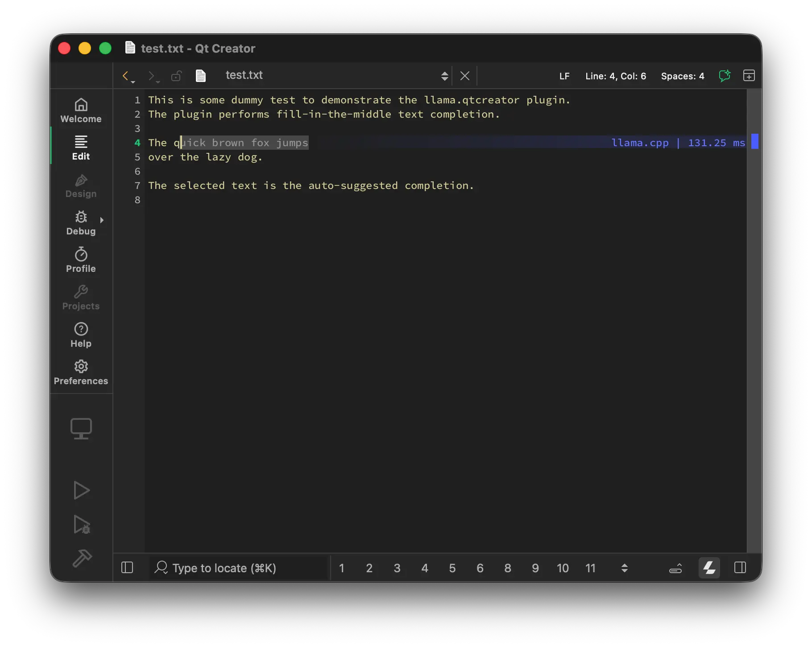
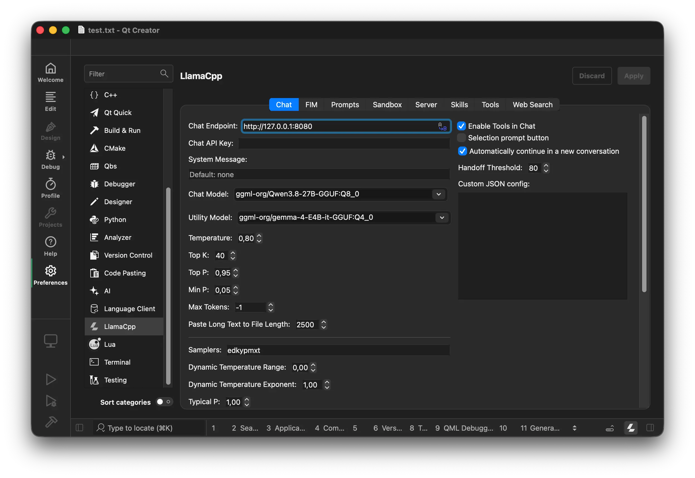
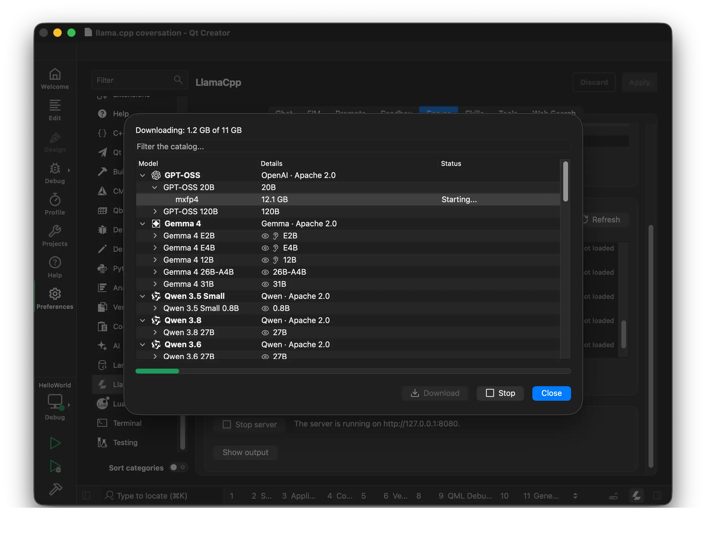
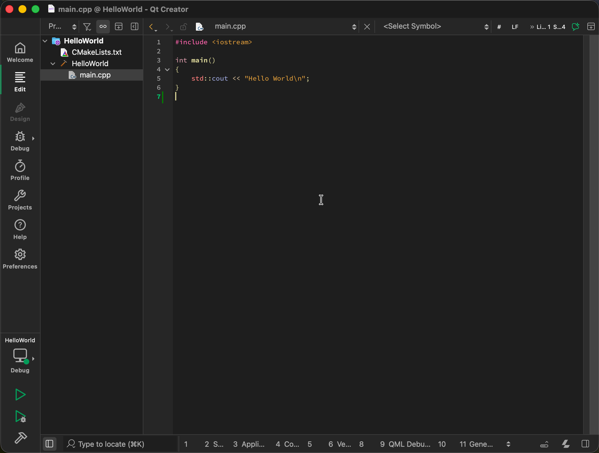

# llama.qtcreator

Local LLM assistance for Qt Creator, powered by a
[llama.cpp](https://github.com/ggml-org/llama.cpp) server: FIM text
completion in the editor and an agentic chat with a built-in agent harness -
shell and file tools, web access, skills, subagents and sandboxing -
rendered with Markdown, Mermaid and KaTeX, no cloud required.



## Features

### Text completion

- Auto-suggest on cursor movement. Toggle enable / disable with `Ctrl+Shift+G`
- Trigger the suggestion manually by pressing `Ctrl+G`
- Accept a suggestion with `Tab`
- Accept the first line of a suggestion with `Shift+Tab`
- Control max text generation time
- Configure scope of context around the cursor
- Ring context with chunks from open and edited files and yanked text
- [Supports very large contexts even on low-end hardware via smart context reuse](https://github.com/ggml-org/llama.cpp/pull/9787)
- Speculative FIM support
- Speculative Decoding support
- Display performance stats

### Chat

- Chat support (including [Mermaid](https://mermaid.js.org/) diagrams and [KaTeX](https://katex.org/) math, rendered to SVG with a bundled QuickJS runtime - no browser required)
- "Human Editor" endpoint: select it in the chat's model dropdown to use the chat as a Markdown editor - replies are written by you in a regular text editor opened in a split next to the chat (save to send), and assistant messages can be edited in place the same way
- Source and Image drag & drop support
- "ll" locator (type `ll` in the locator, or use the selection prompt button in the editor): send the current editor selection to the model with a built-in or custom prompt - prompts support `{selection}`, `{file}`, `{line}`, `{diagnostics}` and `{git_diff}` placeholders, and are editable on the "Prompts" settings page
- Project instructions: the project's `AGENTS.md` / `CLAUDE.md` (searched up to the git repository root) is loaded and appended to the chat system message; can be disabled globally or per project
- [Skills](https://agentskills.io): configure skill directories on the "Skills" settings page; skills (`SKILL.md` files) are advertised to the model and loaded on demand via the `skill` tool
- Conversations get automatic titles, long conversations are automatically continued in a new conversation seeded with a handoff summary of the task, current state and next steps when they approach the model's context window, and messages sent while a reply is in progress are queued
- The conversations view supports multi-selection (Ctrl/Shift+click), and the Delete key removes the selected conversations (task conversations nested under a deleted parent are re-parented to the top level)
- Export a conversation as Markdown or HTML

### Chat tools

- File tools (`read_file`, `write`, `edit_file`, `apply_patch`), code
  navigation (`search`, `find`, `ls`), `bash`, `get_datetime` / `get_info`
  (current date/time and working environment), `todo_write`, and `task`
  (delegates a self-contained subtask to a subagent that works in a
  separate conversation, shown nested under its parent in the conversation
  list)
- Web access: `webfetch` retrieves and reads pages, `websearch` queries
  Exa, Google, Brave or Tavily (API keys configured on the "Tools" settings
  page)
- [MCP](https://modelcontextprotocol.io/) support: configure multiple MCP
  servers on the "Tools" settings page and enable their tools individually
- Sandboxing: optionally run the chat tools in a sandbox (per-project
  setting) - `bwrap` on Linux, `sandbox-exec` on macOS and
  [Microsoft MXC](https://github.com/microsoft/mxc) on Windows. Writes are
  restricted to the project directory and temp locations, credential
  locations (e.g. `~/.ssh`, `~/.aws`) are denied, and network access is
  blocked by default; extra writable/readable/deny-read directories and the
  network policy are configured on the "Sandbox" settings page

### llama.cpp setup

The plugin requires a [llama.cpp](https://github.com/ggml-org/llama.cpp) server instance to be running at:



Or let the plugin manage the server itself: the **Server** settings page
(Settings > llama.cpp > Server)

- Finds or downloads the runtime (the official llama.cpp install script -
  the same one the Llama tray apps use, so an existing install is picked
  up), and starts/stops `llama-server` with a configurable host, port,
  models directory and extra arguments
- Shows the server's output (start command line, then the colored log) in
  a dedicated "llama.cpp" pane of the Output window
- Checks the install channel for newer builds; can start the server when
  Qt Creator starts (stops it on exit)
- Lists the server's models with their details, and loads/unloads or
  removes them
- "Download models..." downloads a model from the llama.app catalog into
  the server's model cache
- A "Models" submenu in the "llama.cpp" menu (Tools > llama.cpp) and in
  the status icon's context menu lists the server's models - selecting one
  loads it and makes it the active chat model (selecting it again unloads
  it) - and starts/stops the managed server
- A chat API key (Chat settings page), when set, is required by the
  managed server as well

The chat's model selection is remembered across restarts, and the
configured FIM and utility models are loaded automatically (the FIM model
on its own server when the FIM endpoint points at a different one).




### FIM llama.cpp settings

Here are recommended settings, depending on the amount of VRAM that you have:

- More than 16GB VRAM:

  ```bash
  llama-server --fim-qwen-7b-default
  ```

- Less than 16GB VRAM:

  ```bash
  llama-server --fim-qwen-3b-default
  ```

- Less than 8GB VRAM:

  ```bash
  llama-server --fim-qwen-1.5b-default
  ```

Use `llama-server --help` for more details.


### Recommended LLMs

The plugin requires FIM-compatible models for the text completion: [HF collection](https://huggingface.co/collections/ggml-org/llamavim-6720fece33898ac10544ecf9)

The chat works with any chat model supported by `llama-server` (a separate
endpoint can be configured for it).

## Examples

### Chat on a Mac Studio M2 with `gpt-oss 20B`:



## Other IDEs

- Vim/Neovim: https://github.com/ggml-org/llama.vim
- VS Code: https://github.com/ggml-org/llama.vscode
